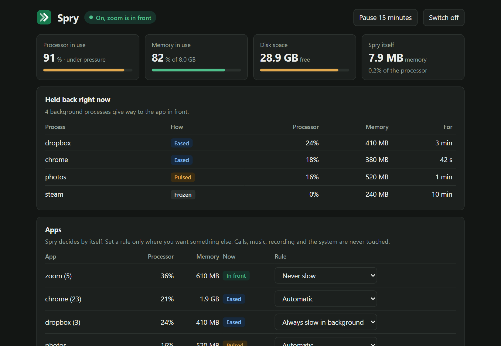
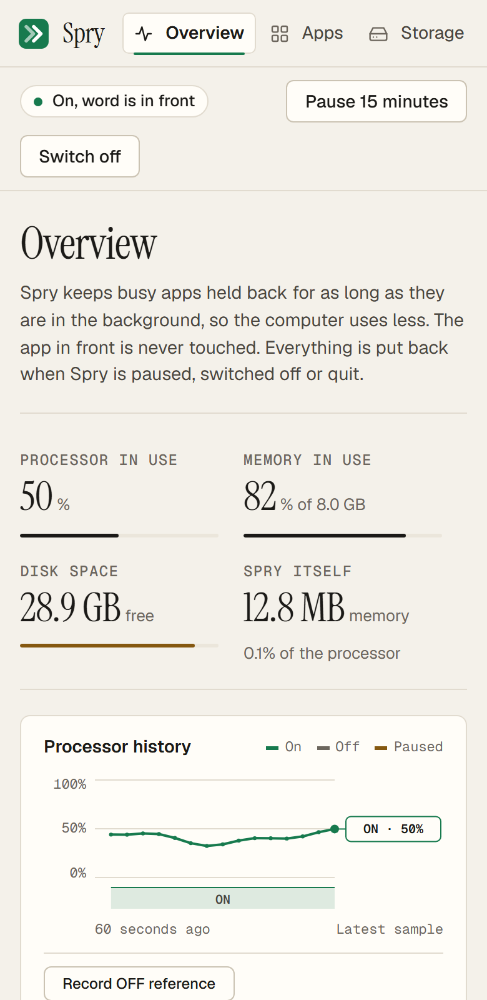

<p align="center"></p>

# Spry

**Keeps an old computer quick.** Spry watches which app you are using and holds the busy apps
behind it back, so the one in front gets the processor. While the app in front rests (you read,
think, or step away), the others get the processor back, so they are not kept waiting for nothing.
When you switch apps, it switches with you. When Spry stops, everything is exactly as it was.

One small program for **Windows, macOS and Linux**. Free and open source (MIT). No account, no
internet connection needed, no administrator rights.


<sub>The real page, shown with example apps. **How** says what Spry is doing to a process (eased,
pulsed, frozen, or at full speed while the app in front rests; explained under
[How it works](#how-it-works)); **For** says how long. The page follows your system's light or dark
setting and fits a small window:</sub>

<p>&nbsp;</p>

## What you get

Measured by the program itself (`spry bench`) on GitHub's test machines, which have 3 or 4 processor
threads like many older laptops. The test starts twice as many busy background processes as the
machine has threads, then measures how much work the app in front gets done and how fast it reacts
to a click. On Windows and Linux the test is repeated with only 2 threads allowed, as a stand-in for
a smaller machine.

<!-- bench:start -->
| System | Runs | Threads | Kept free | Quiet | Busy, Spry off | Busy, Spry on | Gain (lowest-highest) | Of quiet speed | With Strong mode | Slowest 5% of reactions, off -> on |
|---|---|---|---|---|---|---|---|---|---|---|
| Windows, x64 | 5 | 4 | 2 | 252 | 189 | 251 | **1.32x** (1.29-1.37) | 100% | not offered | 8.4 -> 4.2 ms |
| macOS 15, Apple silicon | 5 | 3 | none | 243 | 106 | 237 | **2.17x** (1.91-4.06) | 93% | 2.37x | 5.1 -> 5.9 ms |
| macOS 15, Intel | 5 | 4 | none | 249 | 93 | 241 | **2.48x** (1.99-3.03) | 99% | 2.68x | 4.4 -> 4.4 ms |
| Linux (Ubuntu), x64 | 5 | 4 | 2 | 249 | 113 | 250 | **2.20x** (2.02-2.85) | 100% | 2.20x | 12.1 -> 4.2 ms |
| Windows, x64, on 2 threads only | 5 | 2 | 1 | 251 | 76 | 241 | **3.03x** (2.74-3.89) | 96% | not offered | 4.3 -> 4.1 ms |
| Linux (Ubuntu), x64, on 2 threads only | 5 | 2 | 1 | 250 | 89 | 229 | **2.60x** (2.52-2.61) | 91% | 2.63x | 14.1 -> 4.3 ms |
| Linux (Ubuntu), ARM64 | 5 | 4 | 1 | 251 | 104 | 249 | **2.39x** (1.84-2.89) | 99% | 2.40x | 12.0 -> 4.1 ms |
| Linux (Ubuntu), ARM64, on 2 threads only | 5 | 2 | 1 | 251 | 84 | 251 | **3.02x** (2.03-3.10) | 100% | 3.02x | 11.9 -> 4.0 ms |

Each row is the median over its CI runs ([44508838506](https://github.com/juw12/spry/actions/runs/44508838506), [44508849036](https://github.com/juw12/spry/actions/runs/44508849036), [44508870158](https://github.com/juw12/spry/actions/runs/44508870158), [44508880495](https://github.com/juw12/spry/actions/runs/44508880495), [44510374146](https://github.com/juw12/spry/actions/runs/44510374146)). Work is in steps per second.
<!-- bench:end -->

These runs were made with the 0.3.1 code. The gain is measured against the same plain busy
processes as in every earlier version, and with Strong mode off, which is how Spry now comes on
every system.

**The weak results, said plainly:**

- On the Windows test machine with all 4 threads the gain is still the smallest (1.32x), because
  Windows already gives the app in front most of what it needs. With Spry it reaches 100% of a quiet
  machine. The gain there also depends on which processor the test machine happens to have: when
  the released 0.2.1 and 0.3.0 were measured in turns on the same six machines
  ([run 44504694485](https://github.com/juw12/spry/actions/runs/44504694485), values in
  `docs/bench/ab-0.2.1/`), both gave 1.26-1.30x on one processor model and 1.33-1.47x on the three
  others, and on the same machine 0.3.0 was never more than 0.03 below 0.2.1. The five runs of
  0.3.0 gave 1.38x here and these five give 1.32x, with nothing changed in between for the time
  the app in front works.
- On macOS a normal program cannot keep part of the processor free, and how apps are held while
  the app in front works has not changed since 0.1.1. The two macOS test machines vary most
  between runs, so read their rows as "about twice", not to the decimal: Apple silicon gave 1.91x
  to 4.06x in these five runs and reaches 93% of a quiet machine. Intel gives 2.48x (99% of quiet)
  now, where the five runs of 0.3.0 gave 2.12x (90%) and those of 0.2.0 gave 2.28x, with the same
  code for this part each time. Reactions on the two macOS test machines were already short
  (4 to 5 ms) and did not get shorter; on Apple silicon they were a little longer with Spry on
  (5.1 -> 5.9 ms).
- The app in front is furthest from a quiet machine on Linux limited to 2 threads (91%).
- After the app in front has rested, the hold is not back at once: 0.6 to 1.1 seconds on the test
  machines (see the next section). An app in front that keeps using more than 5% of one processor
  core while you only look at it (a video call, a page with moving pictures) never counts as
  resting, so nothing is lent then.
- The app in front in this test uses one processor thread. An app that uses all of them gains less:
  it has the kept-free threads to itself and shares the rest. That case is not measured yet.
- The "2 threads only" rows are the same test machines limited to two threads. Nobody has measured
  Spry on a real old laptop yet.

**From version to version**, same test machines, same load, median gain:

<!-- bench-change:start -->
| System | 0.1.1 | 0.2.0 | 0.3.1 (now) | With pulses, 0.2.0 | With pulses, now |
|---|---|---|---|---|---|
| Windows, x64 | 1.27x | 1.39x | 1.32x | - | - |
| macOS 15, Apple silicon | 2.21x | 2.13x | 2.17x | 2.17x | 2.37x |
| macOS 15, Intel | 2.10x | 2.28x | 2.48x | 2.50x | 2.68x |
| Linux (Ubuntu), x64 | 1.09x | 2.36x | 2.20x | 2.37x | 2.20x |
| Windows, x64, on 2 threads only | - | 2.99x | 3.03x | - | - |
| Linux (Ubuntu), x64, on 2 threads only | - | 2.53x | 2.60x | 2.56x | 2.63x |
| Linux (Ubuntu), ARM64 | - | 2.07x | 2.39x | 2.09x | 2.40x |
| Linux (Ubuntu), ARM64, on 2 threads only | - | 3.01x | 3.02x | 3.01x | 3.02x |
<!-- bench-change:end -->

The first three columns are easing only, with no process ever stopped; the last two add the pulses
of Strong mode. Version 0.1.1 had nothing on Linux that held the processor back without pausing
apps (1.09x), and reached 92% of a quiet machine on Windows. Versions 0.3.0 and 0.3.1 did not
change how apps are held while the app in front works, so where the "now" column differs from 0.2.0
(lower on Windows and Linux x64, higher on macOS Intel and Linux ARM64) that is the spread between
runs and test machines, not a change in Spry. The five runs of 0.3.0, with the same code for this
part, show how wide that spread is: 1.38x on Windows, 2.90x on Linux x64, 2.12x on macOS Intel and
2.78x on Linux ARM64. What 0.3 changed is in the next section. The reaction times of 0.1.1 (up to 126 ms on macOS) were
mostly the test's own timer waking late on these virtual machines, so they are not compared here;
since 0.2.0 every reaction is timed from a click sent by a second thread. The earlier results are
kept in `docs/bench/v0.1/`, `docs/bench/v0.2/` and `docs/bench/v0.3.0/`.

- **Quiet** = nothing else running. **Busy, Spry off** = background processes take what they want.
  **Busy, Spry on** = the same load, held back by Spry as it comes, with no setting changed.
- **With Strong mode**: the gain with pulses added (macOS and Linux). Since 0.3.0 Strong mode is off
  everywhere until you tick it, also on Linux: there the pulses added almost nothing for the app in
  front and cost the held apps a large part of their speed (see
  [What it costs the apps that are held](#what-it-costs-the-apps-that-are-held)). If you used an
  earlier version, your saved settings are kept, so Strong mode stays on until you untick it.
- **Kept free**: how many processor threads background apps stay off while the machine is under
  pressure (Windows and Linux; macOS gives a normal program no way to do this).
- **Slowest 5% of reactions**: a second thread "clicks" 60 times a second; this is how long the app
  in front takes to answer, for the slowest twentieth of the clicks.
- These are shared virtual machines and the numbers move between runs, which is why the lowest and
  highest gain are shown. Your computer will differ, so measure it: press **Measure now** on the page
  (under a minute), or run `spry bench`.

**What Spry itself costs.** Measured half a minute after a fresh install on the same test machines
([install check of 0.2.0, run 44476935590](https://github.com/juw12/spry/actions/runs/44476935590)):

| System | Memory | Processor once settled | Processor time in the first 35-45 s, start included |
|---|---|---|---|
| Windows | 12.5 MB | 0.1% of one core | 0.14 s |
| macOS, Apple silicon | 30.3 MB | 1.4% of one core | 0.55 s |
| macOS, Intel | 21.1 MB | 1.2% of one core | 0.96 s |
| Linux, x64 | 1.3 MB | 0.1% of one core | under 0.01 s |
| Linux, ARM64 | 1.3 MB | 0.1% of one core | under 0.01 s |

On a busy machine it looks more often. One reading taken by hand, not from a linked run: on the
author's Windows PC (8 cores, 370 processes, 75% busy) it used 7.7 MB and about 2% of one core.

## What it costs the apps that are held

Holding an app back means it gets less done. Up to 0.2 that was true all the time: a held app
stayed held while you were reading or away, when nothing needed the processor. Since 0.3.0 the time
is lent: while the app in front rests, the held apps run as if Spry were not there.

Measured in the same runs as the table above, with a second set of busy background processes that
count their own work. 100% is what they get done with Spry off.

<!-- bench-cost:start -->
| System | Front app works: held (lowest-highest) | Front app rests: held anyway (0.2) | The same with pulses (0.2 on Linux) | Front app rests: lent (now, lowest-highest) | Hold back after (slowest) |
|---|---|---|---|---|---|
| Windows, x64 | 56% (55-57) | 50% | not offered | **100%** (99-100) | 1.1 s (1.1 s) |
| macOS 15, Apple silicon | 54% (17-86) | 55% | 30% | **99%** (97-102) | 0.8 s (1.1 s) |
| macOS 15, Intel | 95% (64-115) | 93% | 32% | **100%** (82-104) | 0.6 s (0.9 s) |
| Linux (Ubuntu), x64 | 54% (54-55) | 50% | 20% | **100%** (99-101) | 0.8 s (0.9 s) |
| Windows, x64, on 2 threads only | 49% (37-62) | 48% | not offered | **100%** (100-101) | timed on all threads only |
| Linux (Ubuntu), x64, on 2 threads only | 56% (55-61) | 50% | 20% | **100%** (100-100) | timed on all threads only |
| Linux (Ubuntu), ARM64 | 80% (80-82) | 75% | 30% | **100%** (100-100) | 1.0 s (1.0 s) |
| Linux (Ubuntu), ARM64, on 2 threads only | 57% (57-60) | 50% | 20% | **100%** (100-100) | timed on all threads only |
<!-- bench-cost:end -->

- **Front app works: held** is what the held apps still get done while the app in front is busy.
  This part is the price of the gain and has not changed: the processor is finite, and while you
  work the others wait.
- **Front app rests: held anyway** is what they got up to 0.2 while the app in front did nothing,
  and **the same with pulses** is what they got on Linux as 0.2 came, or anywhere with Strong mode
  ticked. This is the time that was lost for nothing.
- **Front app rests: lent** is what they get now.
- **Hold back after** is how long after the app in front starts working again the others are held
  again, timed in a test that runs the whole program (median, and the slowest of the five runs).
  During that moment the app in front shares the processor as if Spry were off.

Said plainly: on the macOS Apple silicon test machine the "front app works" figure went from 17% to
86% between runs (3% to 76% in the runs of 0.3.0), so that row says little; the system's background
state there can leave a held app almost nothing. On macOS Intel two of the five runs showed the
lent apps at 82% and 90% of their free speed; every other reading in that column is 97% or more.
And a rest only
counts after 6 seconds below 5% of one processor core, so short pauses between keystrokes lend
nothing.

**On a real, busy computer the test machines were wrong about Windows.** The test machines run
nothing but the test. The author's Windows PC (8 threads) was busy with his own background jobs,
which run at a lower priority than normal. There 0.3.0, released an hour before, lent far less
than the table said: it gave the processor threads back but left the lent apps at lower priority,
and they had to share with those other jobs. 0.3.1 gives the priority back as well. Both released
downloads, run in turns on that PC (`spry bench`, readings taken by hand, kept in
`docs/bench/by-hand/`):

| On that PC, while the app in front rests | Held apps get, of their speed with Spry off |
|---|---|
| Lent by 0.3.0 (four readings) | 38%, 41%, 48%, 51% |
| Lent by 0.3.1 (two readings) | **99%, 106%** |
| Not lent, held the way 0.2 did (all six readings) | 0% to 2% |

The same readings show the price while the app in front works more sharply than the test machines
do: the held apps got 0% to 2.5% of their free speed there, not about half. One reason is the test
itself: it holds only its own background processes, so the author's other jobs, which were not
held, went ahead of them. With Spry running for real those jobs would be held as well and all of
them would share what the app in front leaves. That case has not been measured. The app in front
gained 1.96x to 2.21x on that PC (90% to 99% of a quiet machine) in the same six readings.

## What it cannot do

- It does not add memory or make the processor faster. It decides who goes first. Work in the
  background takes longer while the app in front is working, and runs at full speed whenever it
  rests. How much longer is measured under
  [What it costs the apps that are held](#what-it-costs-the-apps-that-are-held).
- If the app in front is slow by itself with nothing else running, Spry changes nothing.
- A computer that is out of memory stays out of memory. On Windows, Spry can ask large background
  apps to give back memory they are not using; on macOS and Linux the system does not offer that.
- While the app in front works and the machine is under pressure, background apps on Windows and
  Linux run on fewer processor threads (on a 4-thread machine: 2), so they take longer. That is the
  price of the gain above. They get every thread back when the app in front rests.
- The downloads are not signed yet, so Windows and macOS warn on first start (see Install). They
  can be checked another way: see "Check a download" under Install.

## Install

**Windows 10 or 11**

1. Download [spry-windows-x64.zip](https://github.com/juw12/spry/releases/latest/download/spry-windows-x64.zip).
2. Open the zip and drag `spry.exe` to a folder you keep, for example Documents.
3. Double-click `spry.exe`. Windows shows "Windows protected your PC" because the file is not signed
   yet: choose **More info**, then **Run anyway**.

**macOS 11 or newer** (Apple silicon and Intel). Open Terminal, paste this line, press Return:

```sh
curl -fsSL https://raw.githubusercontent.com/juw12/spry/main/install.sh | sh
```

This is the easy way on a Mac: a download through the browser is blocked by macOS until you allow it
in System Settings > Privacy & Security, because Spry is not signed by Apple yet.

**Linux** (x64 and ARM64): the same line as macOS. Spry has to see which app is in front:

| Desktop | Does Spry see the app in front? |
|---|---|
| Any desktop on X11 | Yes. |
| Wayland with sway | Yes, tested on every change. |
| Wayland with Hyprland or niri | Written from their documentation, not yet tried on a real session. `spry front` tells you. |
| Wayland with GNOME or KDE (the default on current Ubuntu and Fedora) | No: these desktops do not tell other programs. Spry then only follows the rules you set on its page, so it helps less there. |

**After the first start** Spry opens its page in your browser and works at once, with no settings.
It sits in the tray (Windows) or the menu bar (macOS); on Linux, run `spry open` for the page.
Tick **Start Spry when I sign in** on the page to keep it. The page lists the apps that are busy,
held back or have a rule; apps that are doing nothing are folded away behind one button.

**To undo everything:** press **Quit Spry** on the page (every app is put back at that moment), untick
"Start Spry when I sign in", and delete the file. Spry leaves nothing else behind except a small
settings folder.

People who prefer a terminal on Windows: `irm https://raw.githubusercontent.com/juw12/spry/main/install.ps1 | iex`

**Check a download.** Every file on the [release page](https://github.com/juw12/spry/releases/latest)
has its SHA-256 checksum next to it (`<file>.sha256`). The install lines above compare the two and
install nothing when they differ. Each file also has a build record, signed by GitHub, that says
which source commit and which workflow produced it. With the
[GitHub command line tool](https://cli.github.com/):

```sh
gh attestation verify spry-linux-x64.tar.gz -R juw12/spry
```

This shows the file was built from this repository's source by its release workflow, and not
changed afterwards. It is not the same as a signature from Microsoft's or Apple's programmes, so the
first-start warnings on Windows and macOS remain.

## How it works

Every half second Spry asks the system which app is in front. Every two seconds (every five while
the computer is calm) it measures all running apps.

- **The app in front is never touched**, together with everything it started and the app that
  started it.
- An app you just left keeps full speed for 10 seconds.
- A background app that uses more than 10% of one processor core is **eased**: it only gets the
  processor when the app in front does not need it.
- When the whole processor is above 80% for 4 seconds, easing goes deeper. On Windows and Linux,
  eased apps then stay off part of the processor (about a quarter of the threads, in whole cores,
  never more than half), so the app in front always finds a free one. Strong mode (off until you
  tick it) also **pulses** the heaviest background processes (120 ms paused, 80 ms running).
- **The time is lent.** When the app in front and everything it started have used less than 5% of
  one processor core for 6 seconds, the held apps get the whole processor back and the page shows
  them at "Full speed". Spry then looks twice a second, and the hold returns as soon as the app in
  front works again. Switching to another app counts as working. Apps you set to "always slow" or
  "freeze" are not lent anything, and one tick on the page ("Lend idle time") switches this off.
- You can set a rule per app: never slow, always slow in the background, or **freeze** in the
  background (fully paused until you switch back to it).
- Calls, music, recording and the desktop are on a built-in "never touched" list, and every program
  that lives in a system folder is skipped whatever its name.

What "eased" means on each system:

| System | Eased | Notes |
|---|---|---|
| Windows 10/11 | Lower priority class. Under pressure also Efficiency mode, low memory priority, and part of the processor kept free. | Also releases unused memory of large background apps when memory runs low. An app that picked its own processor threads keeps them. |
| macOS 11+ | The system's background state (what `taskpolicy -b` sets): lowest processor priority, throttled disk. | Apple silicon and Intel. |
| Linux | Idle disk priority. Under pressure part of the processor is kept free. | A normal user cannot raise a priority again after lowering it, so Spry does not lower it; which threads an app may use can be put back, so Spry uses that, and gives every thread back exactly what it had. |

## Safety

- **Everything is put back** when you pause Spry, switch it off or quit it. Spry saves what each
  process looked like before, and restores exactly that.
- If Spry is killed or the computer crashes, the list of held processes is on disk: the next start,
  or `spry rescue`, puts them back. A frozen app is resumed the same way.
- If an app changes its own priority (browsers do this for their tabs) or picks its own processor
  threads while Spry holds it, Spry leaves that choice alone and does not undo it.
- The system is left alone twice over: Spry runs without administrator rights, so it cannot reach
  system services or other users' apps; and it skips every program that lives in a system folder
  (`C:\Windows`, `/System`, `/usr/libexec` and the like) as well as a built-in list of desktop,
  sound, call, music and recording apps. Apps that come with the system, such as Photos or Safari,
  count as apps.
- The page is served on `127.0.0.1` only and needs a secret token that is created on your computer.
- Storage cleaning shows what it found and removes nothing until you choose. It only looks at
  caches, temporary files and the bin, never at documents, downloads or app data.

This is tested on every change, on Windows, macOS (Apple silicon and Intel) and Linux (x64 and
ARM64) ([CI](https://github.com/juw12/spry/actions/workflows/ci.yml)): a real busy process is eased,
paused, frozen, kept off part of the processor, and put back; Spry is killed and `spry rescue` puts
the process back; on Linux, a process that picks its own processor threads while held keeps them.
A second check ([install](https://github.com/juw12/spry/actions/workflows/install.yml)) runs the
install steps from this page on each system, confirms the installed Spry starts and answers, feeds
the installer a changed download and confirms it is refused, and verifies the build record of every
download.

Each promise above has a test with a name you can read, run on every change:

| Promise | Test |
|---|---|
| Everything is put back, exactly | `easing_shows_and_is_put_back_exactly`, `freezing_stops_the_process_and_thawing_starts_it_again`, `under_pressure_part_of_the_processor_is_kept_free_and_given_back` in [tests/roundtrip.rs](https://github.com/juw12/spry/blob/main/tests/roundtrip.rs) |
| Put back after Spry is killed | `eases_shows_restores_and_rescues` in [tests/end_to_end.rs](https://github.com/juw12/spry/blob/main/tests/end_to_end.rs) |
| An app's own choice is left alone | `a_priority_the_app_set_itself_is_never_undone`, `a_choice_the_app_made_itself_while_eased_is_left_alone` in [tests/roundtrip.rs](https://github.com/juw12/spry/blob/main/tests/roundtrip.rs) |
| Held apps get full speed while the app in front rests, and the hold is back within 3 seconds | `lends_while_the_front_app_rests_and_holds_again_when_it_works` in [tests/end_to_end.rs](https://github.com/juw12/spry/blob/main/tests/end_to_end.rs), `lending_gives_the_speed_back_and_the_hold_can_return`, `the_fresh_reading_sees_the_front_app_work_and_rest`, `the_main_reading_sees_a_process_stop_completely` in [tests/roundtrip.rs](https://github.com/juw12/spry/blob/main/tests/roundtrip.rs), `held_apps_are_lent_the_time_while_the_front_app_rests`, `nothing_is_lent_when_switched_off_by_rule_or_without_a_known_front_app` in [src/policy.rs](https://github.com/juw12/spry/blob/main/src/policy.rs) |
| The app in front is never touched | `busy_background_is_eased_and_the_front_app_is_not`, `focus_on_a_child_window_covers_the_whole_app` in [src/policy.rs](https://github.com/juw12/spry/blob/main/src/policy.rs) |
| System programs and the "never touched" list are skipped | `programs_that_belong_to_the_system_are_recognised_by_where_they_live` in [src/config.rs](https://github.com/juw12/spry/blob/main/src/config.rs), `never_slow_and_protected_are_left_alone` in [src/policy.rs](https://github.com/juw12/spry/blob/main/src/policy.rs) |
| The page answers only with the token | `eases_shows_restores_and_rescues` (asks without and with a wrong token) in [tests/end_to_end.rs](https://github.com/juw12/spry/blob/main/tests/end_to_end.rs) |
| Storage: looking removes nothing, and only caches, temporary files and the bin are looked at | `sweep_removes_only_old_files_and_keeps_the_root`, `only_folders_well_inside_home_or_temp_are_accepted`, `no_cleaning_folder_is_inside_your_own_files` in [src/clean.rs](https://github.com/juw12/spry/blob/main/src/clean.rs) |

What went wrong along the way, so you can judge the testing. The largest fault got past every
test: 0.3.0 was released lending less than it claimed on Windows. It gave the processor threads back
but kept the lower priority, which costs nothing on a test machine that runs only the test, and cost
half the speed on a real PC busy with other work (see
[What it costs the apps that are held](#what-it-costs-the-apps-that-are-held)). It was found by
running the released download on a real PC and fixed in 0.3.1 the same day; the test that a lent
process looks exactly as it did before Spry touched it now runs on Windows as well as macOS. The
five CI runs behind the table all passed. A sixth
([44508859482](https://github.com/juw12/spry/actions/runs/44508859482)) passed on four machines
and was cancelled while still waiting for a macOS Apple silicon machine, so no test failed in it
and it is not in the table. Getting to 0.3.0 took several corrections. A new test failed 2 of 13 times
on macOS Intel; it was a real fault, not a shaky test: on macOS a process that had stopped
completely kept showing its last reading, so Spry could go on thinking a resting app was working.
After the fix the test passed 56 of 56 times. A second new test failed on Windows because the first
reading of a process that has just appeared is always about 0 there; the test now skips it. The
first way of measuring what the hold costs made the busy processes count their work, which changed
the load itself; measuring the released 0.2.1 beside it on the same machines showed that, and the
gain is now measured against the untouched processes with a separate counting set for the cost.
The same comparison showed that the Windows gain depends on the test machine's processor model.
One check did not pass on the five runs of 0.3.0: the median gain of every row was to be at least
the lowest 0.2.0 run of that row, and "Linux, ARM64, on 2 threads only" gave 3.005x against 3.007x,
a row where the app in front already runs at 100% of a quiet machine. On the five runs of 0.3.1 the
same check passes, by as little (3.025x against 3.007x in that row, 1.32x against 1.30x on
Windows), so it says more about the spread of these machines than about Spry.

Two of the seven runs of 0.1.1 failed a test on macOS Intel (one test expected one held process where Spry rightly held two;
one measured a busy process while other tests ran beside it). Both were faults in the tests and are
fixed. The reaction-time column of 0.1.1 measured the test's own timer more than Spry (see above).
The install check also showed 0.1.0 easing two
macOS system helpers it did not know by name. That was put back as always, and 0.1.1 skips every
program in a system folder.

## Commands

```
spry              start Spry and open its page
spry open         open the page of the running Spry
spry status       show what is being held back right now
spry bench        measure the effect on this computer (under a minute)
spry clean        show what storage can be cleared; add --yes to clear it
spry install      start Spry when you sign in      (spry uninstall undoes it)
spry rescue       put processes back after a crash
spry front        show the process id of the app in front (checks that Spry can see it)
```

`spry bench --threads 2` runs the measurement on two processor threads only (Windows and Linux).

On Windows, Spry is a windowed program, so in a terminal add `| more` to read the output of
`spry status` or `spry bench`.

## Other tools

Spry is the only one of these that runs on all three systems.

| Tool | System | Price |
|---|---|---|
| [Process Lasso](https://bitsum.com/) | Windows | Free version; Pro from $39.95 for one PC ([Bitsum](https://bitsum.com/get-lasso-pro/), checked 2026-11-19) |
| [App Tamer](https://www.stclairsoft.com/AppTamer/) | macOS | Paid, see the maker's page |
| [ananicy-cpp](https://gitlab.com/ananicy-cpp/ananicy-cpp), [cpulimit](https://github.com/opsengine/cpulimit) | Linux | Free, open source, set up by hand |
| **Spry** | Windows, macOS, Linux | Free, open source |

Process Lasso and App Tamer are older and have more settings. Spry is for people who want it to
work without settings.

## Build from source

```sh
cargo build --release      # Rust 1.88 or newer
cargo test --release       # starts real busy processes for a few seconds
```

The numbers in "What you get" are rebuilt from the CI results in `docs/bench/` with
`python docs/bench/summary.py`.

## Licence

MIT. Made by [Juwen Lie](https://github.com/juw12).
