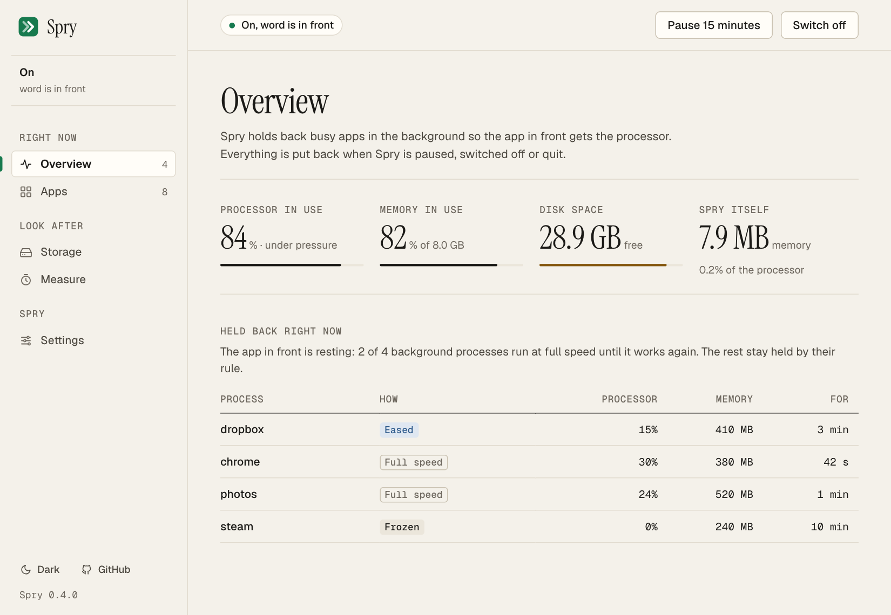

<p align="center"></p>

# Spry

**Keeps an old computer quick.** Spry watches which app you are using and holds the busy apps
behind it back, so the one in front gets the processor. When you switch apps, it switches with you.
When Spry stops, everything is exactly as it was.

One small program for **Windows, macOS and Linux**. Free and open source (MIT). No account, no
internet connection needed, no administrator rights.



<sub>The real page, shown with example apps. It follows your system's light or dark setting and fits a
small window: [dark](docs/dashboard-dark.png), [narrow](docs/dashboard-phone.png).</sub>

## What you get

Measured by the program itself (`spry bench`) on GitHub's test machines, which have 3 or 4 processor
cores like many older laptops. The test starts twice as many busy background processes as the
machine has cores, then measures how much work the app in front gets done.

<!-- bench:start -->
| System | Cores | Quiet | Busy, Spry off | Busy, Spry on | Gain (lowest-highest) | Of quiet speed | Easing only | With pulses | Slowest 5% of steps, off -> on |
|---|---|---|---|---|---|---|---|---|---|
| Windows, x64 | 4 | 250 | 180 | 228 | **1.26x** (1.25-1.27) | 91% | 1.26x | not used | 20.6 -> 5.0 ms |
| macOS 15, Apple silicon | 3 | 220 | 101 | 245 | **2.36x** (2.13-2.46) | 103% | 2.23x | 2.36x | 67.4 -> 73.5 ms |
| macOS 15, Intel | 4 | 256 | 119 | 249 | **2.14x** (2.04-2.96) | 100% | 2.10x | 2.14x | 126.3 -> 109.8 ms |
| Linux (Ubuntu), x64 | 4 | 252 | 89 | 218 | **2.45x** (2.23-2.88) | 87% | 1.09x | 2.45x | 15.0 -> 15.1 ms |

Median of 3 CI runs ([44464015119](https://github.com/juw12/spry/actions/runs/44464015119), [44464540756](https://github.com/juw12/spry/actions/runs/44464540756), [44465145704](https://github.com/juw12/spry/actions/runs/44465145704)). Work is in steps per second.
<!-- bench:end -->

**The weak results, said plainly:** on the Windows test machine the gain is small (1.26x), because
Windows already gave the app in front most of what it needed there; what improved is the reaction
time (the last column). On Linux, easing alone does almost nothing for the processor; the gain comes
from pulses. On the two macOS test machines the reaction time did not improve; the amount of work did.

- **Quiet** = nothing else running. **Busy, Spry off** = background processes take what they want.
  **Busy, Spry on** = the same load, held back by Spry (the better of "easing only" and "with pulses").
- **Easing only** is the default on Windows and macOS. **With pulses** is "Strong mode": the default on
  Linux, one tick on the page elsewhere.
- **Slowest 5% of steps**: how long a short piece of work takes after a pause, like reacting to a click.
- These are shared virtual machines and the numbers move between runs, which is why the lowest and
  highest gain are shown. Your computer will differ, so measure it: press **Measure now** on the page
  (20 seconds), or run `spry bench`.

Spry itself uses about 8 MB of memory and 0.1-0.3% of the processor (measured on Windows with
370 processes running: 7.7 MB, 2.2% of one of 8 cores).

## What it cannot do

- It does not add memory or make the processor faster. It decides who goes first. Work in the
  background takes longer while you use something else, and gets its speed back when you stop.
- If the app in front is slow by itself with nothing else running, Spry changes nothing.
- A computer that is out of memory stays out of memory. On Windows, Spry can ask large background
  apps to give back memory they are not using; on macOS and Linux the system does not offer that.
- The downloads are not signed yet, so Windows and macOS warn on first start (see Install).

## Install

**Windows 10 or 11**

1. Download [spry-windows-x64.zip](https://github.com/juw12/spry/releases/latest/download/spry-windows-x64.zip).
2. Open the zip and drag `spry.exe` to a folder you keep, for example Documents.
3. Double-click `spry.exe`. Windows shows "Windows protected your PC" because the file is not signed
   yet: choose **More info**, then **Run anyway**.

**macOS 11 or newer** (Apple silicon and Intel). Open Terminal, paste this line, press Return:

```sh
curl -fsSL https://raw.githubusercontent.com/juw12/spry/main/install.sh | sh
```

This is the easy way on a Mac: a download through the browser is blocked by macOS until you allow it
in System Settings > Privacy & Security, because Spry is not signed by Apple yet.

**Linux** (x64): the same line as macOS. Spry needs X11 to see which app is in front. On Wayland
(the default on current Ubuntu and Fedora) it cannot see that, and only follows the rules you set
on its page, so it helps less there.

**After the first start** Spry opens its page in your browser and works at once, with no settings.
It sits in the tray (Windows) or the menu bar (macOS); on Linux, run `spry open` for the page.
Tick **Start Spry when I sign in** on the page to keep it.

**To undo everything:** press **Quit Spry** on the page (every app is put back at that moment), untick
"Start Spry when I sign in", and delete the file. Spry leaves nothing else behind except a small
settings folder.

People who prefer a terminal on Windows: `irm https://raw.githubusercontent.com/juw12/spry/main/install.ps1 | iex`

## How it works

Every half second Spry asks the system which app is in front. Every two seconds (every five while
the computer is calm) it measures all running apps.

- **The app in front is never touched**, together with everything it started and the app that
  started it.
- An app you just left keeps full speed for 10 seconds.
- A background app that uses more than 10% of one processor core is **eased**: it only gets the
  processor when the app in front does not need it.
- When the whole processor is above 80% for 4 seconds, easing goes deeper, and Strong mode also
  **pulses** the heaviest background processes (120 ms paused, 80 ms running).
- You can set a rule per app: never slow, always slow in the background, or **freeze** in the
  background (fully paused until you switch back to it).
- Calls, music, recording, the desktop and the system are on a built-in "never touched" list.

What "eased" means on each system:

| System | Eased | Notes |
|---|---|---|
| Windows 10/11 | Lower priority class. Under pressure also Efficiency mode and low memory priority. | Also releases unused memory of large background apps when memory runs low. |
| macOS 11+ | The system's background state (what `taskpolicy -b` sets): lowest processor priority, throttled disk. | Apple silicon and Intel. |
| Linux | Idle disk priority, and pulses under pressure. | A normal user cannot raise a priority again after lowering it, so Spry does not lower it. Needs X11 to see the app in front; on Wayland Spry only follows the rules you set. |

## Safety

- **Everything is put back** when you pause Spry, switch it off or quit it. Spry saves what each
  process looked like before, and restores exactly that.
- If Spry is killed or the computer crashes, the list of held processes is on disk: the next start,
  or `spry rescue`, puts them back. A frozen app is resumed the same way.
- If an app changes its own priority (browsers do this for their tabs), Spry leaves that app alone.
- The system is left alone twice over: Spry runs without administrator rights, so it cannot reach
  system services or other users' apps; and it skips every program that lives in a system folder
  (`C:\Windows`, `/System`, `/usr/libexec` and the like) as well as a built-in list of desktop,
  sound, call, music and recording apps. Apps that come with the system, such as Photos or Safari,
  count as apps.
- The page is served on `127.0.0.1` only and needs a secret token that is created on your computer.
- Storage cleaning shows what it found and removes nothing until you choose. It only looks at
  caches, temporary files and the bin, never at documents, downloads or app data.

This is tested on every change, on Windows, macOS (Apple silicon and Intel) and Linux
([CI](https://github.com/juw12/spry/actions/workflows/ci.yml)): a real busy process is eased,
paused, frozen, and put back; Spry is killed and `spry rescue` puts the process back. A second check
([install](https://github.com/juw12/spry/actions/workflows/install.yml)) runs the install steps from
this page on each system and confirms the installed Spry starts and answers.

## Commands

```
spry              start Spry and open its page
spry open         open the page of the running Spry
spry status       show what is being held back right now
spry bench        measure the effect on this computer (about 20 seconds)
spry clean        show what storage can be cleared; add --yes to clear it
spry install      start Spry when you sign in      (spry uninstall undoes it)
spry rescue       put processes back after a crash
```

On Windows, Spry is a windowed program, so in a terminal add `| more` to read the output of
`spry status` or `spry bench`.

## Other tools

Spry is the only one of these that runs on all three systems.

| Tool | System | Price |
|---|---|---|
| [Process Lasso](https://bitsum.com/) | Windows | Free version; Pro from $39.95 for one PC ([Bitsum](https://bitsum.com/get-lasso-pro/), checked 2026-11-19) |
| [App Tamer](https://www.stclairsoft.com/AppTamer/) | macOS | Paid, see the maker's page |
| [ananicy-cpp](https://gitlab.com/ananicy-cpp/ananicy-cpp), [cpulimit](https://github.com/opsengine/cpulimit) | Linux | Free, open source, set up by hand |
| **Spry** | Windows, macOS, Linux | Free, open source |

Process Lasso and App Tamer are older and have more settings. Spry is for people who want it to
work without settings.

## Build from source

```sh
cargo build --release      # Rust 1.88 or newer
cargo test --release       # starts real busy processes for a few seconds
```

The numbers in "What you get" are rebuilt from the CI results in `docs/bench/` with
`python docs/bench/summary.py`.

## Licence

MIT. Made by [Juwen Lie](https://github.com/juw12).
